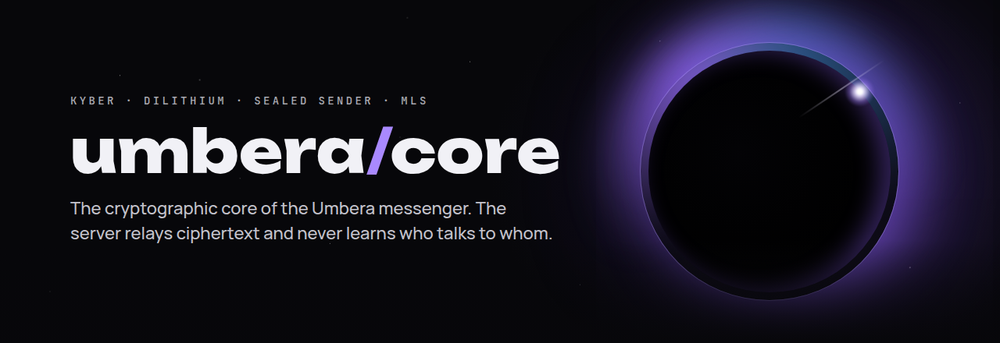
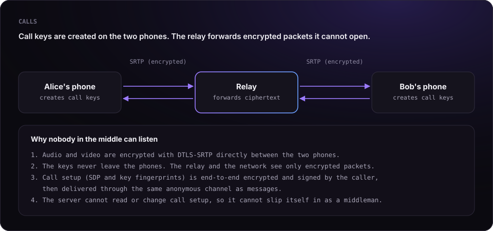

<p align="center">
  
</p>

# Proof: nobody but the recipient can read your messages, group chats or calls

This document makes three precise claims and gives you the means to check each of them yourself.
Nothing here asks to be taken on trust: every step points to code you can read, tests you can run,
or traffic you can capture.

## The claims

1. **Messages.** Only the intended recipient can read a message. The Umbera server, the hosting
   provider, the network and anyone who copies the server's database see only ciphertext.
2. **Group chats.** Only the current members of a group can read its messages. A person who is not
   a member, a removed member and the server cannot read them, and a new member cannot read what was
   sent before they joined.
3. **Calls.** Only the two participants can hear or see a call. The relay that forwards call traffic
   and anyone on the network see only encrypted packets, and the server cannot insert itself between
   the participants.

## Assumptions

A proof is only as honest as its assumptions. These claims hold under the following conditions:

| Assumption | Why it matters |
|---|---|
| The participants' phones are not compromised | Malware on a device can read the screen; no messenger can prevent that |
| The recipient does not share the content | Encryption cannot stop someone from forwarding what they received |
| The standard primitives are secure | ML-KEM-1024 or X25519, AES-256-GCM, HKDF-SHA256, DTLS-SRTP |
| You verify a contact's keys when it matters | Key transparency and key pinning warn you if a contact's keys change |

---

## 1. Messages

### How it works

```
plaintext
  └─ Double Ratchet (per conversation, keys only on the two phones)
       └─ inner package: sender identity + ratchet ciphertext
            └─ sealed to the recipient:
                 ephemeral X25519  +  ML-KEM-1024 (Kyber) encapsulation
                 → HKDF-SHA256 → AES-256-GCM
                      └─ padded to a fixed size bucket
                           └─ delivered to a mailbox address only the two peers can compute
```

The server receives a mailbox address and a padded ciphertext. The key needed to open it is derived
from the recipient's private keys, which are generated on the recipient's phone and never leave it.

### Where to check it in the code

| Step | File | What to look for |
|---|---|---|
| Ratchet encryption | [`DoubleRatchet.kt`](../kotlin/src/commonMain/kotlin/app/umbera/core/crypto/DoubleRatchet.kt) | message keys derived and discarded on the device |
| Sealing to the recipient | [`MessageEncryption.kt`](../kotlin/src/commonMain/kotlin/app/umbera/core/crypto/MessageEncryption.kt) | `createSealedSenderHybridPQ`: fresh ephemeral key per message, Kyber encapsulation, AES-256-GCM |
| Envelope v3 (2.1.0) | [`SealV3.kt`](../kotlin/src/commonMain/kotlin/app/umbera/core/crypto/SealV3.kt) | full envelope: ephemeral X25519 + ML-KEM-1024, HKDF salted with the transcript hash; short envelopes chained from the last full one |
| Combining both secrets | [`HybridKeyExchange.kt`](../kotlin/src/commonMain/kotlin/app/umbera/core/crypto/HybridKeyExchange.kt) | X25519 and Kyber secrets fed into one HKDF |
| Primitives | [`primitives.rs`](../core/src/primitives.rs) | ML-KEM-1024, ML-DSA-65, X25519, AES-256-GCM from RustCrypto and dalek |
| Mailbox addresses | [`MessageEncryption.kt`](../kotlin/src/commonMain/kotlin/app/umbera/core/crypto/MessageEncryption.kt) | `rendezvousIdEpoch`: derived from the two peers' shared secret |
| Padding | [`RendezvousPadding.kt`](../kotlin/src/commonMain/kotlin/app/umbera/core/crypto/RendezvousPadding.kt) | fixed size buckets |
| Key substitution detection | [`KeyTransparencyVerifier.kt`](../kotlin/src/commonMain/kotlin/app/umbera/core/crypto/KeyTransparencyVerifier.kt) | Merkle inclusion proofs and signed tree heads |

### What a delivered message looks like to the server

A stored message consists of a mailbox address, an opaque ciphertext, a type (`message` or `signal`)
and timestamps. There is no sender field, no recipient field and no account identifier attached to it.

### Run it yourself

```bash
git clone https://github.com/UmberaAPP/UMBERA
cd UMBERA/core
cargo test --release
```

The test suite checks every primitive against known-answer vectors and runs ML-KEM-1024 and ML-DSA-65
end to end.

[`tests/proof.rs`](../core/tests/proof.rs) rebuilds the exact sealing used for every message
(ephemeral X25519 + Kyber → HKDF-SHA256 → AES-256-GCM) and proves each property directly:

```bash
cargo test --test proof
```

```
test the_recipient_can_read_the_message ... ok
test the_ciphertext_does_not_contain_the_message ... ok
test anyone_with_other_keys_cannot_read_it ... ok
test breaking_only_x25519_is_not_enough ... ok
test breaking_only_kyber_is_not_enough ... ok
test a_tampered_message_is_rejected ... ok
test every_message_is_sealed_with_fresh_keys ... ok
test result: ok. 7 passed; 0 failed
```

`breaking_only_x25519_is_not_enough` is the post-quantum guarantee: even an attacker who could break
X25519 (for example with a future quantum computer) cannot open a message without the recipient's
Kyber key.

---

## 2. Group chats

### How it works

- Groups use **MLS** (Messaging Layer Security, [RFC 9420](https://www.rfc-editor.org/rfc/rfc9420)) through
  [OpenMLS](https://github.com/openmls/openmls). The code is the `MlsClient` in
  [`core/src/lib.rs`](../core/src/lib.rs), the same one the apps call for every group.
- Every change of membership (add, remove, key update) is a signed **Commit** that moves the group to a
  new **epoch** with fresh keys. Messages are encrypted with the keys of the current epoch only.
- A removed member is cut out of the key tree by the Commit, so they cannot derive the keys of any later
  epoch. A new member receives only the current epoch's secrets in their Welcome, so earlier epochs stay
  closed to them.
- Every member checks the member cap on incoming Commits, not only the admin
  (`member_cap_enforced_at_crypto_layer` in `src/lib.rs`), and every application message carries the
  authenticated sender identity (`application_messages_carry_the_authenticated_sender`).
- Ciphersuite: new groups use `MLS_256_XWING_CHACHA20POLY1305_SHA256_Ed25519` (0x004D), whose KEM is
  X-Wing = X25519 + ML-KEM-768, on OpenMLS 0.9.2. An existing group moves to X-Wing by itself once every
  member runs 2.1.0 or Desktop 1.0.0. A group that includes a 2.0.x member stays on
  `MLS_128_DHKEMX25519_AES128GCM_SHA256_Ed25519`, and every group packet still travels to each member
  inside that member's hybrid X25519 + ML-KEM-1024 envelope.
- Every Commit, Proposal and Welcome also carries an ML-DSA-65 signature
  ([`GroupPqSig.kt`](../kotlin/src/commonMain/kotlin/app/umbera/core/crypto/GroupPqSig.kt)), and each device refreshes its own leaf every 7 days.

### Run it yourself

[`tests/proof_groups.rs`](../core/tests/proof_groups.rs) checks each part of the claim directly:

```bash
cd core
cargo test --test proof_groups
```

```
test every_member_can_read_a_group_message ... ok
test the_server_only_sees_ciphertext ... ok
test an_outsider_cannot_read_it ... ok
test a_removed_member_cannot_read_new_messages ... ok
test a_new_member_cannot_read_older_messages ... ok
test a_key_update_moves_the_group_to_a_new_epoch ... ok
test result: ok. 6 passed; 0 failed
```

`an_outsider_cannot_read_it` even gives the outsider her own group under the very same group id —
she still cannot decrypt the real group's messages.

The X-Wing groups, the move of an existing group to X-Wing and the compatibility with the previous core
have their own tests:

```bash
cargo test --release --lib xwing_                  # X-Wing groups
cargo test --release --lib regroup_to_xwing_keeps_leaf_signature_keys
cargo test --release --test xwing_short_key        # malformed and short X-Wing keys are rejected
cargo test --release --test pcs_rekey              # recovery after a compromise, both suites
cargo test --release --test compat_v06             # new core against the previous core (OpenMLS 0.6)
```

---

## 3. Calls

<p align="center"></p>

### How it works

- Audio and video use **DTLS-SRTP**, the encryption built into WebRTC. The DTLS handshake runs
  **directly between the two phones**, so the media keys are created on the phones and never leave them.
- When a direct connection is impossible, traffic goes through a relay (TURN). The relay forwards
  SRTP packets. It never takes part in the DTLS handshake, so it never has the keys.
- A relay or server could only listen in by swapping the DTLS fingerprints during call setup
  (a man-in-the-middle attack). In Umbera, call setup is **end-to-end encrypted with the same scheme
  as messages and signed by the caller**, then delivered through the anonymous mailbox channel. The
  server cannot read the fingerprints and cannot change them without breaking the signature.
  The code is in [`CallSignaling.kt`](../kotlin/src/commonMain/kotlin/app/umbera/core/call/CallSignaling.kt):
  `encryptSignaling` seals every SDP and ICE message, and `decryptSignaling` rejects anything whose
  signature does not match the caller's key (`decryptMessageRaw` in
  [`MessageEncryption.kt`](../kotlin/src/commonMain/kotlin/app/umbera/core/crypto/MessageEncryption.kt)
  throws `Invalid message signature`).
- Since 2.1.0 and Desktop 1.0.0, every audio and video frame (and screen sharing) is encrypted a second
  time, in addition to DTLS-SRTP, with keys from a fresh X25519 + ML-KEM-1024 exchange for each call, carried in
  the end-to-end encrypted call setup. Code: [`core/src/callkey.rs`](../core/src/callkey.rs) and
  [`CallFrameE2ee.kt`](../kotlin/src/commonMain/kotlin/app/umbera/core/webrtc/CallFrameE2ee.kt). With a 2.0.x peer the call runs on DTLS-SRTP alone.
- Group calls connect participants directly to each other, and each pair runs its own exchange. There is
  no server that mixes or decodes media.

### Verify it with a packet capture

You can confirm with standard tools that no unencrypted media leaves your phone:

1. Connect a phone to a Wi-Fi network you control and capture its traffic with Wireshark
   (for example on a laptop sharing its connection).
2. Make an Umbera call.
3. Filter the capture with `dtls || rtp || srtp`.
4. You will see a DTLS handshake followed only by encrypted SRTP packets. Wireshark cannot decode any
   audio or video from them, and there is no plain RTP stream.

---

## Found a flaw?

If you can break any of these claims, we want to know first. Report it privately as described in
[SECURITY.md](../SECURITY.md).

<p align="center"><sub>© 2026 Umbera · <a href="https://umbera.app">umbera.app</a> · <a href="../LICENSE">Apache-2.0</a></sub></p>
